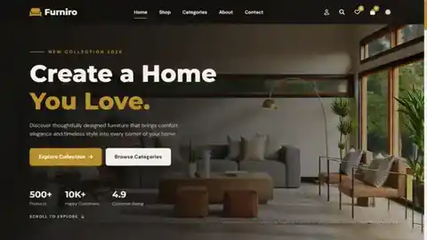

# Furniro – Modern Furniture Store

A responsive furniture e-commerce website concept featuring a clean, modern shopping experience. Browse furniture collections, explore product categories, search for items, and interact with a shopping cart and wishlist.

## 🌐 Live Demo

No public demo URL is currently listed for this repository. Add your deployment URL here when it is ready.

## ✨ Features

- Responsive layout for desktop, tablet, and mobile screens
- Modern furniture-store design and product presentation
- Product categories and collection sections
- Product filtering and search interface
- Product quick-view interface
- Shopping cart sidebar with subtotal display
- Wishlist interaction
- Light/dark theme toggle
- Contact form and newsletter interface
- Mobile navigation menu
- Page loader, notifications, and back-to-top control

## 🛠️ Built With

- HTML5
- CSS3
- Vanilla JavaScript
- Google Fonts (DM Sans and Montserrat)
- Font Awesome icons

## 📸 Website Preview



## 📁 Project Structure

```text
Furniro-Website/
├── Furniro/
│   ├── index.html
│   ├── style.css
│   └── script.js
├── screenshots/
│   └── furniro-home.webp
└── README.md
```

## 🚀 Run Locally

1. Clone this repository:

   ```bash
   git clone https://github.com/syedanoorfatima/Furniro-Website.git
   ```

2. Open the project folder:

   ```bash
   cd Furniro-Website/Furniro
   ```

3. Open `index.html` in your browser, or use the Live Server extension in Visual Studio Code.

## 👩‍💻 Developer

**Syeda Noor Fatima**

- GitHub: [@syedanoorfatima](https://github.com/syedanoorfatima)
- LinkedIn: [Syeda Noor Fatima](https://www.linkedin.com/in/syeda-noor-fatima-webdeveloper)

---

If you like this project, consider giving the repository a ⭐ on GitHub.
